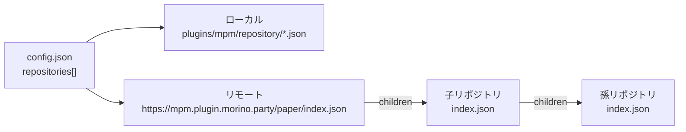

import { Callout } from "fumadocs-ui/components/callout";

mpmにおける**リポジトリ**とは、「どのプラグインを、どこから（Modrinth / GitHub / SpigotMC / Hangar）
ダウンロードするか」を定義したカタログです。`mpm add <プラグイン名>` は、このカタログから
プラグインの定義を探して `mpm.json` に登録します。

## 🧱 構成要素

| 要素 | 役割 | ドキュメント |
| --- | --- | --- |
| リポジトリファイル | プラグイン1件分の定義（`id`、`repositories`、依存関係など） | [リポジトリファイル](/docs/repository/file) |
| リポジトリインデックス | リモートリポジトリが配信する `index.json`。全プラグイン定義と、子リポジトリへのリンクを含む | [リポジトリインデックス](/docs/repository/graph) |
| リポジトリソース | `config.json` で指定する、mpmがカタログを読む場所（ローカルディレクトリ / リモートURL） | [プラグイン設定 (config.json)](/docs/format/config#リポジトリソース) |

## 🗺️ 全体像



- **ローカルソース**は `plugins/mpm/repository/` にリポジトリファイルを1つずつ置くだけの最もシンプルな形です
- **リモートソース**は静的ファイル `index.json` を読みます。インデックスは他のインデックスへリンク（`children`）でき、
  mpmはそれをチェーンのようにたどって1つのカタログに合成します（最大深さ5）
- 複数のソースは `config.json` の並び順で優先され、同名のプラグインは先に見つかった定義が採用されます

<Callout type="info" title="サーバーは不要">
リポジトリはすべて静的ファイルで成り立ちます。GitHub Pagesなどにファイルを置くだけで、
自分のプラグインをmpmから配布できます。詳しくは[リポジトリインデックス](/docs/repository/graph)を参照してください。
</Callout>

## 🏛️ 公式リポジトリ

morinopartyの公式リポジトリは、このドキュメントサイトと同じ `mpm.plugin.morino.party` から配信されています。
対象のサーバーソフトウェアごとに入口となるインデックスが分かれています。

| 対象 | インデックスURL |
| --- | --- |
| Paper | `https://mpm.plugin.morino.party/paper/index.json` |
| Velocity | `https://mpm.plugin.morino.party/velocity/index.json` |

```json title="config.json（公式リポジトリを使う例）"
{
    "repositories": [
        { "type": "local", "path": "repository" },
        { "type": "remote", "url": "https://mpm.plugin.morino.party/paper/index.json" }
    ]
}
```

### 🛰️ チャンネル（Paper）

Paperのルートインデックスはプラグインを直接持たず、成熟度の異なる3つの**チャンネル**を子リポジトリとして束ねています。
各プラグインはちょうど1つのチャンネルに属します。ルートを指定すれば3つのチャンネルすべてを利用でき、
特定のチャンネルだけを使いたい場合はそのチャンネルの `index.json` を直接 `url` に指定します。

| チャンネル | インデックスURL | 内容 |
| --- | --- | --- |
| 🪐 orbit | `https://mpm.plugin.morino.party/paper/channel/orbit/index.json` | Modrinthで配布され、バージョンがきれいに切られているプラグイン（Essentials、PlaceholderAPI、Chunkyなど） |
| 🧩 grid | `https://mpm.plugin.morino.party/paper/channel/grid/index.json` | 標準のチャンネル。orbitとsparkのどちらにも当てはまらないプラグインはここに属します |
| ⚡ spark | `https://mpm.plugin.morino.party/paper/channel/spark/index.json` | バージョンの切り方が不規則なもの、正規表現による補正が多く必要なもの、ベータ版・アルファ版だけが配布されているプラグイン（GSit、CarbonChatなど） |

ルートの `children` は orbit、grid、spark の順に並び、その後ろに外部の子リポジトリ
（MineAuth、MoripaFishing）が続きます。

<Callout type="info" title="チャンネルとバージョンタグは別のもの">
ここでのチャンネルは、カタログ上でプラグインを成熟度ごとに分類したものです。
`mpm add` で指定する `tag:beta` などのバージョンチャンネル（[リポジトリファイル](/docs/repository/file)の
`latest` / `beta` / `alpha`）とは独立しています。
</Callout>

### 🚀 Velocity カタログ

`https://mpm.plugin.morino.party/velocity/index.json` は、Velocityプロキシ向けのjarを配布するプラグインの定義をまとめたカタログです。
各定義の `fileNameRegex` と `versionMatcher` は、Velocity用のjarだけを選ぶように書かれています。
Modrinthの定義は、Velocityローダー（`loaders=["velocity"]`）でバージョン一覧を取得することを前提としています。
Paper版のmpmはModrinthからPaper/Spigot向けのバージョンだけを取得するため、このカタログはPaperサーバーの `config.json` には指定せず、Velocity版のmpmから利用します（[Velocityで使う](/docs/usage/velocity)）。
mpm自身のVelocity版は、GitHubリリースの `mpm-velocity_<tag>.jar` を参照します（Paper版は `mpm_<tag>.jar`）。

### 🗂️ 定義の管理

定義は[GitHubリポジトリ](https://github.com/morinoparty/mpm/tree/main/docs/public)の
`docs/public/paper/channel/<チャンネル>/plugins/*.json` と `docs/public/velocity/plugins/*.json` で管理され、
Pull Requestで追加・修正できます。

<Callout type="warn" title="旧リポジトリについて">
従来の `https://repo.mpm.nikomaru.dev/paper/index.json` も当面は引き続き利用できます。
旧リポジトリは `repo/` ディレクトリで別に管理されており、新しいリポジトリとはファイルを共有していません。
</Callout>

## 関連ドキュメント

- [リポジトリファイル](/docs/repository/file) - プラグイン定義の書き方
- [リポジトリインデックス](/docs/repository/graph) - `index.json` の形式とリンクの解決
- [リポジトリ管理コマンド](/docs/commands/repo) - コマンドリファレンス
